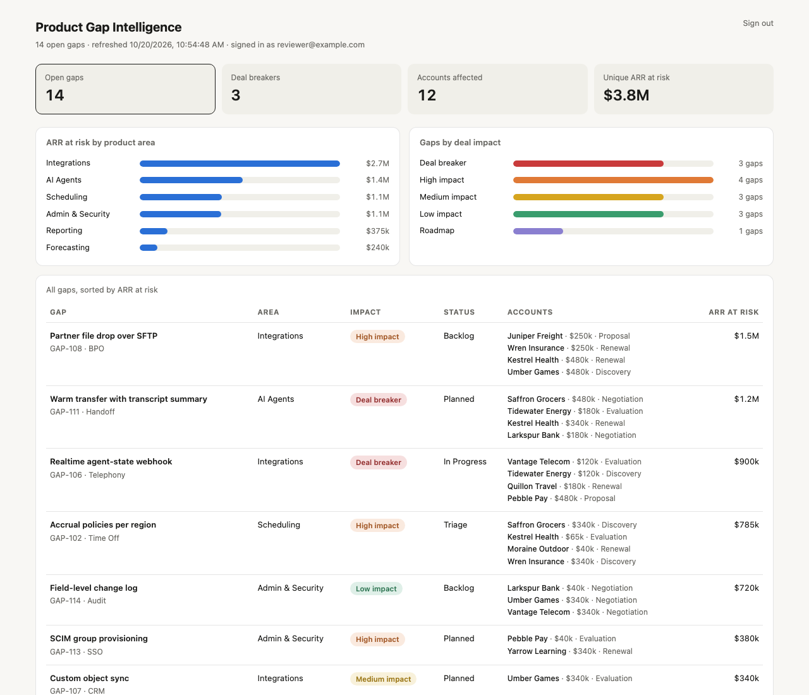

# Product Gap Intelligence

**A revenue-weighted view of the feature requests that block deals, behind an SSO gate.**



## Problem

Sales and solutions teams log product gaps ("we lost this deal because we can't do X") in an issue tracker, but the tracker answers the wrong question. It can sort by priority or date. It can't tell product leadership *how much revenue is waiting on each gap*, which areas of the product keep coming up, or which gaps are actual deal breakers versus nice-to-haves.

## What I built

A small service that reads gap tickets, parses a lightweight convention out of each one, and serves a filterable dashboard:

- **Title convention** `Area → Sub-area → Feature` gives the category hierarchy without custom fields.
- **Labels** carry deal impact (`Deal breaker`, `High impact`, …).
- **Description headings** `### Account | $ARR | Segment | Stage` list every account asking for the gap, so a gap's "ARR at risk" is computed, not typed in.
- **Unique ARR at risk** counts each account once across all gaps, so the headline number isn't inflated when one big account asks for five things.
- Click any tile or bar to filter the table.

The convention is deliberately human-writable. Reps fill it in from a ticket template, and the parser is forgiving (`→` or `->`, `$340k` or `$340,000`).

## The security lesson that shaped it

The dashboard contains account names and revenue figures, so it sits behind Google/OIDC sign-in restricted to a company domain. In the first version, the hosting platform served the repository root as static files *before* falling through to the auth function, so the "private" HTML was publicly downloadable by path. The gate looked like it worked when you visited `/`.

This rebuild makes that class of bug structurally impossible and tests for it:

- The server has **no static file handler at all**. Every response goes through an explicit route table, and the dashboard HTML is read from disk only after the session checks out.
- `test/gate.test.js` requests source paths directly (`/public/dashboard.html`, `/data/…`, `/lib/…`) and asserts they 404.
- Sessions are HMAC-signed, expiring cookies, compared in constant time. OAuth `state` is checked on callback. The domain allowlist also requires `email_verified`.

**Mock data:** [`data/sample-issues.json`](data/sample-issues.json): 14 gap tickets across 12 fictional accounts, written in the tracker convention above.

**Quick look without a server:** open `public/dashboard.html` directly in a browser. Opened from disk it loads [`data/preview.js`](data/preview.js), the same mock data already parsed (rebuild with `npm run preview`), and shows a "static preview" banner. Served normally, the page only ever loads data from the signed-in API, and the server never exposes files in `data/`.

## Run it

```bash
npm run demo     # http://localhost:8787, sign in with any @example.com address
npm test         # 12 tests: parsing, aggregation, and the auth gate
```

For real sign-in, set `OIDC_AUTHORIZE_URL`, `OIDC_TOKEN_URL`, `OIDC_USERINFO_URL`, `OIDC_CLIENT_ID`, `OIDC_CLIENT_SECRET`, `SESSION_SECRET`, `ALLOWED_DOMAINS` and `BASE_URL`, then `npm start`. Point `ISSUES_FILE` at an export, or swap `loadIssues` in `server.js` for a tracker API call.

## Design choices

- **Zero dependencies.** Node's standard library only, so there is nothing to audit or patch in a tool that guards revenue data.
- **Parse, don't add fields.** Custom tracker fields need admin work and break when the tracker changes. A text convention survives exports, copy-paste and tracker migrations.
- **Data in the API, not baked into the page.** The original embedded the data in the HTML. Serving it from `/api/gaps` means the page can be cached or shared without leaking numbers, and the data can refresh live.

All accounts, figures and tickets in `data/` are synthetic.
