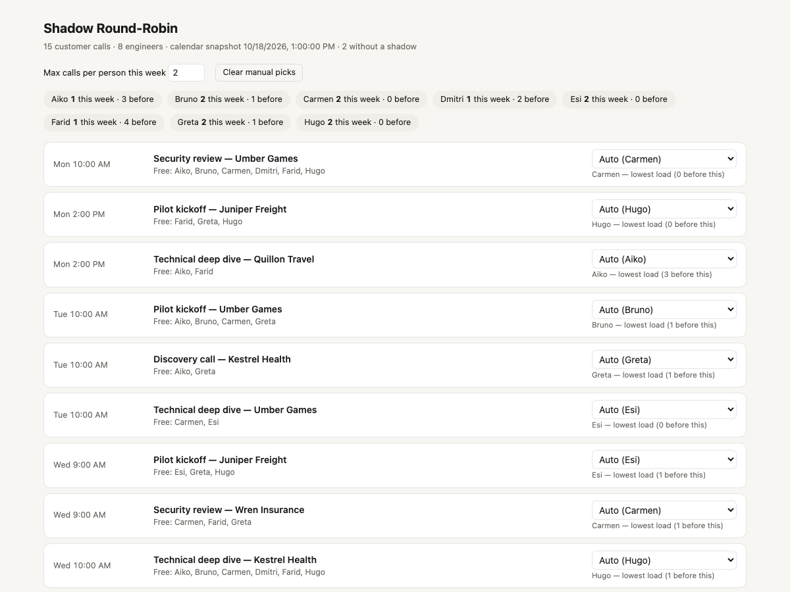

# Fair Round-Robin

**Assigns engineers to shadow customer calls fairly, using calendar free/busy, a weekly cap, and who has already had their turn.**

## Problem

New engineers learn the customer by shadowing sales calls. Done ad hoc, the same few people go every time, others never do, and someone ends up on a call when their calendar was full. The coordinator spends an hour a week in calendars making the assignments by hand.

## How it works

`assign.js` is a pure function:

- **Eligible** = free during the call (from a calendar free/busy snapshot) and under the weekly cap.
- **Pick** the eligible person with the lowest *prior attendance + assignments so far this week*; ties go by roster order so the result is stable.
- **Manual picks win** and consume that person's weekly slot *before* auto-assignment runs, so overriding one call never pushes someone over the cap elsewhere.
- **"No shadow" / "Not needed"** overrides leave a call empty without counting against anyone.
- **Every decision carries a reason** ("lowest load (1 before this)", "everyone free is at the cap", "nobody free"), shown under the call so the coordinator can trust or override it.

`index.html` is a static, single-file console: change the cap or override any call and assignments recompute instantly. Overrides persist in local storage.

**Mock data:** [`snapshot.js`](snapshot.js): 15 calls, 8 engineers, free/busy per call and prior attendance, including a call where nobody is free and one where everyone free is at the cap.

## Run it

Open `index.html` in a browser. Run `npm test` for 5 tests of the assignment rules.

## Design choices

- **Fairness over time, not per week.** Prior attendance is part of the score, so people who missed out recently are first in line.
- **No backend.** The original pulled live calendars through an AI assistant's calendar integration; a refreshable snapshot made a zero-backend version anyone could host as a static page.
- **Explainable by default.** An assignment tool that can't say *why* gets overridden into irrelevance.

Names, calls and calendars in `snapshot.js` are invented.
