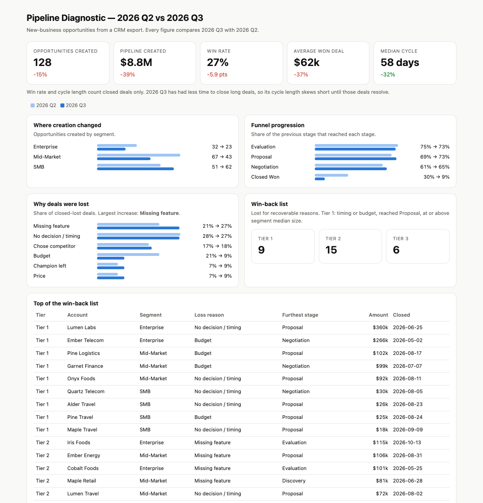

# Pipeline Diagnostic

**A one-page, quarter-over-quarter diagnosis of a sales pipeline from a raw CRM export: where creation dropped, where deals stall, why they're lost, and which ones are worth winning back.**



## Problem

"Pipeline is down this quarter" is where most reviews start and stop. Leadership needs to know *which* segment stopped creating opportunities, *which* stage conversion slipped, *what changed* in loss reasons, and *what to do on Monday*. That usually means a day of spreadsheet pivots.

## How it works

`diagnose.py` reads an opportunity export (one row per opportunity: segment, created date, amount, furthest stage reached, final stage, loss reason, close date) and renders a self-contained HTML report:

- **KPI tiles** with deltas: opportunities and pipeline created, win rate, average won deal, median cycle length.
- **Creation by segment**, so a drop is localized to a segment instead of averaged away.
- **Funnel progression**: the share of each stage that reached the next. Won deals count as reaching every stage.
- **Loss reasons** as shares of closed-lost, with the largest increase called out.
- **Tiered win-back list.** Only recoverable reasons (timing, budget, missing feature, champion left) qualify. Tier 1 is timing or budget, reached Proposal, and at or above the segment's median deal size: the deals most likely to come back with a nudge.

On the sample data the report tells a clear story: mid-market creation fell by about a third (67 → 43), fewer negotiations converted to wins, and "missing feature" had the largest rise of any loss reason, to tie for first (21% → 27% of losses). It also flags its own caveat: Q3 still has deals open, which flatters Q3 cycle length. Together this points to a product-gap conversation, not a sales-execution one, which is why this pairs with [Product Gap Intelligence](../01-product-gap-intelligence).

**Mock data:** [`examples/opportunities.csv`](examples/opportunities.csv): 278 opportunities over two quarters with a built-in mid-market slowdown and some deals still open → rendered report [`examples/pipeline-diagnostic.html`](examples/pipeline-diagnostic.html).

## Run it

```bash
python3 make_sample.py
python3 diagnose.py examples/opportunities.csv --before "2026 Q2" --after "2026 Q3" --out report.html
python3 -m unittest discover -s tests          # 6 tests
```

## How AI helped

The original was built with an AI assistant working from a CRM opportunity pull: it proposed the cuts and generated the report. Codifying it as a script makes the same diagnosis repeatable every quarter, and reviewable, instead of a one-off chat.

All accounts and figures in `examples/` are synthetic.
